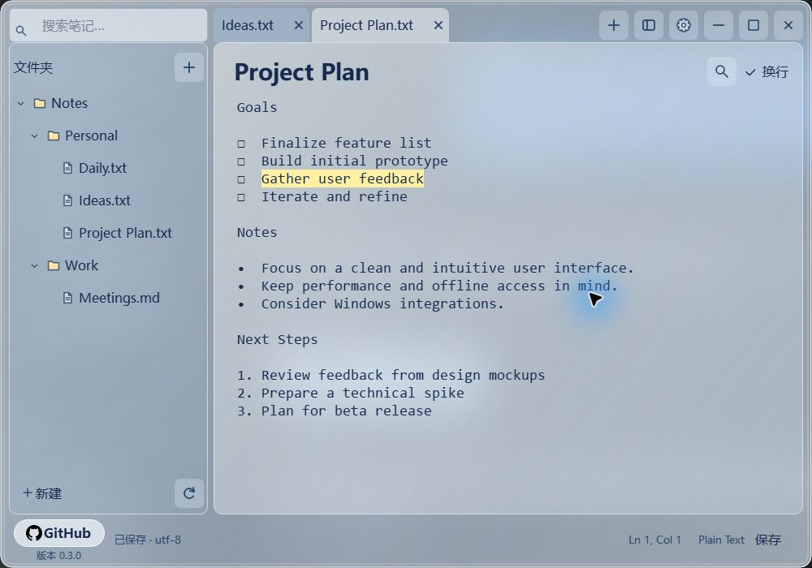
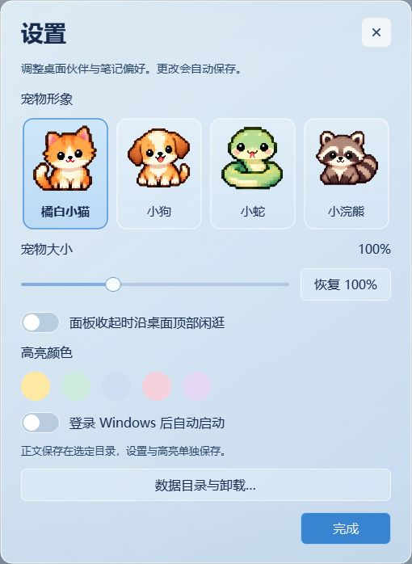

<p align="center">
  
</p>

# NoteFlash

**住在 Windows 桌面顶部的像素伙伴，也是随手打开的本地笔记本。**

NoteFlash 用来管理电脑中已有的 **TXT 和 Markdown 文件**。把常用文件夹加入侧栏，点击桌面宠物展开玻璃笔记面板，即可记录灵感、整理工作清单或搜索本地资料。笔记直接保存在自己的文件夹里，无需账号，也没有云端同步服务。

[项目主页](https://github.com/kevin-sanas/NoteFlash) · [发布版本](https://github.com/kevin-sanas/NoteFlash/releases) · [反馈问题](https://github.com/kevin-sanas/NoteFlash/issues)

## 运行截图

以下为程序实际运行截图。编辑界面使用独立的示例笔记；玻璃颜色会随桌面背景变化，并非概念渲染图。



<p align="center">
  
</p>

## 能做什么

- **管理多个本地文件夹**：展开子目录，在同一侧栏访问 TXT / Markdown；支持新建、重命名、移动和删除。删除先确认，再移入 Windows 回收站。
- **多标签纯文本编辑**：查找替换、撤销重做、自动换行；输入短暂停顿后自动保存，切换标签、收起面板和退出时也保存。下次启动恢复标签。
- **文件名与正文一起搜索**：在加入的文件夹内检索笔记，并从结果打开文件。
- **多色高亮**：选中文字后按 `Alt` 选择颜色；再次选中后可清除。高亮独立记录，不向原始 TXT / MD 插入标记。
- **四种像素伙伴**：橘白小猫、小狗、小蛇和小浣熊；支持休息、闲逛、输入注视、高亮反馈和删除时的进食动作，大小可调至 50%–200%。
- **随用随收起**：单击宠物打开面板，拖动宠物调整位置，展开的面板随之左右移动；面板可调整大小，侧栏可折叠。切换到其他软件时收起，不使用常驻置顶窗口覆盖其他应用。
- **明确的退出与卸载**：关闭按钮仅收起；从托盘或宠物右键菜单选择“彻底退出”才结束进程。设置内可迁移应用数据或确认卸载。

Markdown 当前也以**纯文本**编辑，没有 Typora 式所见即所得、HTML 预览或富文本工具栏。

## 安装与使用

当前版本为 **0.3.0**，实际验证环境为 **Windows 11 x64**。其他 Windows 版本、不同 DPI 和长期高负载场景尚未完成全面验收。

1. 在 [Releases](https://github.com/kevin-sanas/NoteFlash/releases) 查找 `NoteFlash-Setup.exe`。如果尚无发布资产，可按下方步骤自行构建。
2. 运行中文安装器，分别选择**空的安装目录**和**应用数据目录**。安装版自带 Python / Qt 运行时，不需要另外安装 Python。
3. 打开应用，添加自己的笔记文件夹。点击侧栏“新建”创建 `.txt` 或 `.md`，也可打开已有文件。
4. 设置入口在面板右上角齿轮，宠物右键菜单也可打开设置。

下载文件保存在哪里，由浏览器或下载工具选择，与安装位置无关。

也可解压 `NoteFlash-Portable.zip`，保留整个目录结构，运行 `NoteFlash.exe --open`。它是免安装程序包；默认应用数据位于 `%LOCALAPPDATA%\NoteFlash\Data`，并不会自动跟随程序文件夹。要把数据也放到指定位置，可运行：

```powershell
.\NoteFlash.exe --open --data-dir "D:\NoteFlashData"
```

### 常用操作

| 操作 | 快捷键 / 入口 |
| --- | --- |
| 新建笔记 | `Ctrl+N` |
| 保存当前笔记 | `Ctrl+S` |
| 查找与替换 | `Ctrl+F` / `Ctrl+H` |
| 下一个匹配 | `F3` |
| 关闭当前标签 | `Ctrl+W` |
| 标记 / 清除高亮 | 选中文字后按 `Alt` |
| 设置 | 右上角齿轮 / 宠物右键 |
| 彻底退出 | 托盘右键 / 宠物右键 → 彻底退出 |

### 文件与数据

| 内容 | 存放方式 |
| --- | --- |
| 笔记正文及其文件夹 | 保留在用户加入的原始目录 |
| 设置、标签会话、高亮记录 | 安装时选择的独立应用数据目录 |
| 程序及运行库 | 安装时选择的安装目录 |

设置 → **数据目录与卸载** 可以迁移应用数据。迁移不会移动笔记正文。卸载按程序清单清理，保留笔记与未知文件；“清除应用设置与高亮记录”需单独勾选，默认不选。备份时请同时保存笔记文件夹与应用数据目录，才能保留正文和高亮记录。

外部编辑器修改文件后，高亮位置可能无法继续准确对应；应用会检测文件变化，并处理保存冲突。

## 从源码运行

开发验证使用 Python **3.13.5 x64**。在 Windows PowerShell 中执行：

```powershell
git clone https://github.com/kevin-sanas/NoteFlash.git
cd NoteFlash
python -m venv .venv
.\.venv\Scripts\python.exe -m pip install --target .runtime-deps -r requirements-runtime.txt
.\.venv\Scripts\python.exe -B launch.py --open
```

运行依赖固定为 `PySide6-Essentials==6.10.2` 与 `shiboken6==6.10.2`，下载时也会获取它们需要的 Qt 库。开发启动默认把应用状态写入项目的 `.qt-data/`，该目录不会提交到 Git。

如 Python 已在 PATH 中，也可以使用 `run.ps1 -Open` 或 `启动笔记.cmd`。它们使用 PATH 中的 Python；使用虚拟环境时，以上显式解释器命令更明确。

## 构建与源码打包

```powershell
.\.venv\Scripts\python.exe -m pip install --target .build-deps -r requirements-build.txt
.\.venv\Scripts\python.exe -B scripts\build_windows.py
.\.venv\Scripts\python.exe -B scripts\package_source.py
```

构建依赖包括 PyInstaller，版本已固定在 `requirements-build.txt` 中。构建会实际打开一个短暂的 Qt 验证窗口，检查启动、中文自动保存和正常退出；需在可交互的 Windows 桌面会话中运行。

输出位置：

```text
dist/
  qt-candidate/
    NoteFlash-Setup.exe        中文安装包
    NoteFlash-Portable.zip     免安装程序包
    NoteFlash/                 解包后的完整应用
  NoteFlash-0.3.0-source.zip    可公开的源码包
```

不要只复制 `NoteFlash.exe` 而遗漏同目录的 `_internal` 运行库。构建脚本会隔离依赖查找路径，避免第三方同名 ICU DLL 导致 `QtCore` 加载失败。

源码包只包含运行源码、构建脚本、必要素材、公开文档和许可证。正式测试与回归脚本保留在开发者本地，需求草稿、交接文档、用户数据、日志、构建缓存及临时截图均由 `.gitignore` 排除；README 的两张截图位于公开的 `docs/images/`。

## 资源占用

宠物素材按需加载；休息时降低刷新频率，被遮挡的静态宠物停止绘制刷新，面板收起时暂停文件监测。

以下为 2026-10-30 的 0.3.0 候选安装版短时基线，每个场景采样 20 秒。本次开源整理仅调整分发文件、截图及许可，未对重新打包后的文件再次采样。内存单位为 MiB；CPU 的 **100% 表示占满一个逻辑核心**，测试电脑有 16 个逻辑核心。

| 场景 | 平均私有内存 | 平均工作集 | 平均 CPU |
| --- | ---: | ---: | ---: |
| 休息 | 47.66 | 111.23 | 0.156% |
| 遮挡 | 48.36 | 116.10 | 0.469% |
| 闲逛 | 47.60 | 111.62 | 1.875% |
| 持续编辑 | 54.51 | 128.17 | 19.609% |
| 12 个标签 | 74.62 | 144.21 | 6.172% |
| 重复全文搜索 | 60.28 | 131.94 | 32.578% |

编辑样本约 2500 行，每 180 ms 输入一次；搜索样本 501 个文件，每 1.2 秒重搜。遮挡测试的辅助窗口也计入同一进程。采样时固定场景、禁用失焦收起，但使用真实 Windows Qt 窗口与托盘。这些数据不代表长期内存保证或所有电脑的结果。

安装后的保存、退出菜单动作、卸载保留文件已做隔离验证；真实登录启动、独立卸载窗口的完整交互以及全部桌面层级场景仍需进一步实机验证。

## 许可证与致谢

项目自身代码采用 [MIT License](LICENSE)，允许使用、修改与分发，并要求保留版权和许可声明。

Qt / PySide6 / Shiboken 等第三方组件不因本项目采用 MIT 而改变其许可证。组件版本、许可文本、来源及源码获取方式见 [THIRD_PARTY_NOTICES.md](THIRD_PARTY_NOTICES.md) 与 [licenses/](licenses/)。

像素伙伴和 Logo 来自本项目设计过程中的生成素材；GitHub 图标来自 Octicons。宠物行为设计参考了 VPet 与 Shimeji 的分阶段行为思想，未引入它们的引擎、代码或角色素材。
